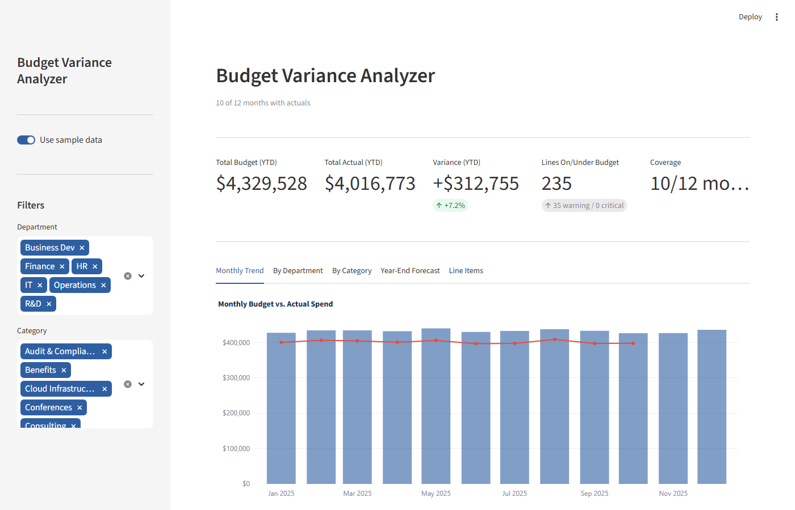
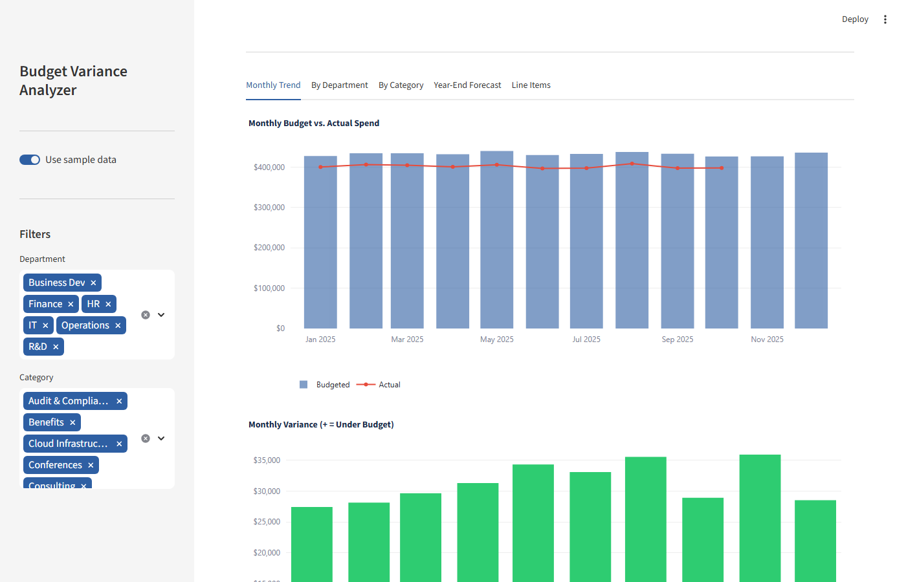
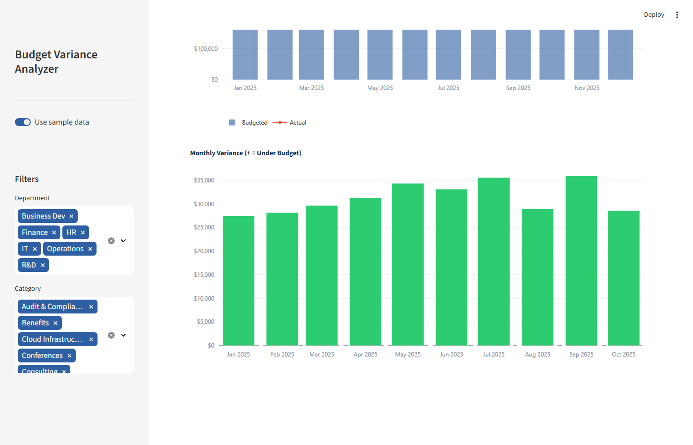

# Budget Variance Analyzer


A Streamlit dashboard for comparing budgeted vs. actual spending across departments, cost categories, and months. Classifies every line item by variance status, projects year-end spend from YTD run rate, and supports uploading your own budget CSV.

---

## Business Problem

Monthly budget reviews require assembling spend data from multiple sources, computing variances manually, and rebuilding the same pivot tables each period. When actuals arrive mid-month or future months carry only budget figures, it is easy to accidentally include incomplete rows in totals or misclassify a line item as on-track when it is approaching a threshold.

Finance teams and budget analysts use this tool to answer three recurring questions: where are we relative to plan right now, which departments and categories are driving overruns, and where will we end the year if current spending patterns continue.

---

## Solution Approach

The pipeline has five stages:

**Load** — `src/data_loader.py` reads a CSV with columns `month`, `department`, `category`, `budgeted`, and `actual`. Rows where `actual` is blank (future months) are loaded with `actual = NaN` rather than zero, so they are explicitly excluded from YTD aggregations.

**Compute variance** — `src/variance_engine.py` calculates for each row that has an actual:

```
variance     = budgeted − actual      (positive = under budget)
variance_pct = variance / budgeted
```

**Classify** — Each `variance_pct` is mapped to a status using fixed thresholds (`WARN_THRESHOLD = 0.05` and `CRITICAL_THRESHOLD = 0.15`, module-level constants in `src/variance_engine.py`; they are intentionally not adjustable in the UI, see [ED-2](docs/ENGINEERING_DECISIONS.md)):

| Status | Condition | Meaning |
|---|---|---|
| FAVORABLE | variance_pct > +5% | Spending is more than 5% under budget |
| ON BUDGET | −5% ≤ variance_pct ≤ +5% | Within acceptable tolerance |
| WARNING | −15% ≤ variance_pct < −5% | Moderately over budget |
| CRITICAL | variance_pct < −15% | Significantly over budget |
| NO ACTUALS | actual is blank | Future period — not yet evaluated |

**Aggregate** — `src/reporter.py` builds the per-tab view DataFrames and KPI dict consumed by the dashboard: department summary, category summary, monthly trend, top variances, and portfolio KPIs. It imports from `variance_engine` internally for row-level classification.

**Forecast** — `forecast_year_end` in `src/variance_engine.py` projects full-year spend by computing average monthly burn rate from YTD actuals and multiplying by 12, producing a per-department/category forecast and forecast variance.

---

## Key Features

- **Portfolio KPI tiles** — total YTD budget, total YTD actual, aggregate variance (dollar and percent), line item status counts, and month coverage
- **Monthly Trend tab** — budget vs. actual bar/line overlay and a monthly variance waterfall (green = under budget, red = over)
- **By Department tab** — grouped bar chart comparing budget to actual per department with a color-coded status table
- **By Category tab** — horizontal diverging bar chart showing variance by category; positive = under budget, negative = over
- **Line Items tab** — full row-level table filterable by status with CSV download
- **Year-End Forecast tab** — department-level forecast grouped bar and forecast variance table
- **File upload** — toggle between sample data and an uploaded CSV matching the five-column schema
- **Sidebar filters** — department and category multiselects that update all five tabs simultaneously

---

## Skills Demonstrated

| Skill | Implementation |
|---|---|
| Financial variance analysis | `variance = budgeted − actual`; `variance_pct = variance / budgeted`; sign convention (positive = under budget) |
| Threshold-based classification | Four-status model (FAVORABLE / ON BUDGET / WARNING / CRITICAL) with exact boundary logic |
| Year-end run-rate forecasting | Monthly burn rate from YTD actuals × 12 per department/category |
| Pandas aggregation | `groupby`, `agg`, `sum`, `value_counts`, `nunique`, `sort_values`, `nlargest`, `nsmallest` |
| Time series handling | `parse_dates`, `pd.Timestamp`, NaN coercion for future-period rows, month-level grouping |
| Plotly multi-chart types | `go.Bar`, `go.Scatter`, `px.bar` (horizontal), grouped bar, variance waterfall, `add_hline` |
| Streamlit multi-tab layout | `st.tabs` (5 tabs), `st.metric`, `st.dataframe`, `st.sidebar`, `st.columns` |
| Streamlit caching | `@st.cache_data` on sample data loader |
| Data validation | Column set validation at system boundary; `ValueError` for missing columns and empty files |
| CSV export | `st.download_button` with named file |
| Conditional Styler formatting | Currency, percent, per-status color via `DataFrame.style.map` |
| pytest boundary condition testing | Exact threshold values, NaN propagation, zero-budget edge case, input immutability |

---

## Tech Stack

| Component | Library / Version |
|---|---|
| Dashboard | Streamlit ≥ 1.32.0 |
| Data processing | pandas ≥ 2.0.0 |
| Charts | Plotly ≥ 5.18.0 |
| Testing | pytest ≥ 7.4.0 |
| Language | Python 3.11+ |

---

## Architecture

```
          data/sample/sample_budget.csv (or user upload)
                           │
                           │ reads
                           ▼
              ┌─────────────────────────────────────┐
              │         src/data_loader.py           │
              │  load_csv · load_sample · validate   │
              └─────────────────────────────────────┘
                           │ raw DataFrame
                           ▼
┌──────────────────────────────────────────────────────────────────┐
│                      app/main.py  (hub)                          │
│               Streamlit Dashboard · 5 tabs                       │
│  imports directly from data_loader, variance_engine, reporter    │
└────────────────────┬────────────────────────┬────────────────────┘
                     │                        │
                     ▼                        ▼
      ┌──────────────────────────┐  ┌────────────────────────────┐
      │  src/variance_engine.py  │  │      src/reporter.py       │
      │  compute_variance        │◄─│  department_summary        │
      │  classify_variance       │  │  category_summary          │
      │  forecast_year_end       │  │  monthly_trend             │
      │  STATUS_COLOR            │  │  top_variances             │
      └──────────────────────────┘  │  portfolio_kpis            │
                     │              └────────────────────────────┘
                     ▼
              ┌──────────────────┐
              │   CSV download   │
              │ (Line Items tab) │
              └──────────────────┘
```

`app/main.py` imports directly from all three `src` modules — it is not a linear pipeline. `src/reporter.py` also holds an internal dependency on `src/variance_engine` (`◄─`) for row-level classification.

See `docs/ARCHITECTURE.md` for the full module reference, variance classification model, and design decisions.

---

## Project Structure

```
budget-variance-analyzer/
├── app/
│   └── main.py                       # Streamlit entry point
├── data/
│   └── sample/
│       └── sample_budget.csv         # 12 months × 6 departments × 4–5 categories
├── docs/
│   ├── ARCHITECTURE.md               # System diagram, module reference, design decisions
│   ├── DATA_DICTIONARY.md            # Input schema, computed columns, forecast schema
│   ├── ENGINEERING_DECISIONS.md      # Six annotated architecture decisions with trade-offs
│   └── TESTING.md                    # Test inventory and known gaps
├── scripts/
│   └── generate_sample_data.py       # Reproducible sample data generator
├── screenshots/
│   ├── 01_overview.png               # Application overview with KPI tiles and monthly trend
│   ├── 02_core_feature.png           # Department and category variance breakdown
│   └── 03_results.png                # Line items table and year-end forecast
├── src/
│   ├── __init__.py                   # Public API exports
│   ├── data_loader.py                # CSV loading and column validation
│   ├── variance_engine.py            # Variance computation, classification, forecasting
│   └── reporter.py                   # Aggregation functions for dashboard tabs
├── tests/
│   ├── __init__.py
│   ├── test_data_loader.py           # 17 tests — load_csv, load_sample, _validate
│   ├── test_reporter.py              # 25 tests — all aggregation functions
│   └── test_variance_engine.py       # 30 tests — variance engine and forecast
├── .github/
│   └── workflows/
│       └── tests.yml                 # CI: Python 3.11, pytest
├── .streamlit/
│   └── config.toml                   # Dashboard theme
├── CHANGELOG.md
├── LICENSE
└── requirements.txt
```

---

## Quick Start

**Requirements:** Python 3.11+

```bash
git clone https://github.com/RichieGarafola/budget-variance-analyzer.git
cd budget-variance-analyzer

python -m venv .venv
source .venv/bin/activate        # Windows: .venv\Scripts\activate

pip install -r requirements.txt
streamlit run app/main.py
```

The app opens at `http://localhost:8501` with sample data loaded by default.

---

## Sample Data

### CSV Schema

```
month, department, category, budgeted, actual
```

| Column | Type | Notes |
|---|---|---|
| `month` | Date | Any pandas-parseable date (e.g., `2025-01-01`) |
| `department` | String | Department or cost center name |
| `category` | String | Expense category (Salaries, Travel, Software Licenses, etc.) |
| `budgeted` | Numeric | Planned spend for that department/category/month |
| `actual` | Numeric or blank | Actual spend — leave blank for future months |

The included `data/sample/sample_budget.csv` covers 12 months (January–December 2025) across six departments (Business Dev, Finance, HR, IT, Operations, R&D). Months November and December have no actuals, demonstrating `NO ACTUALS` handling for future periods.

To regenerate the sample dataset:

```bash
python scripts/generate_sample_data.py
```

---

## Usage

The app opens at `http://localhost:8501` with sample data loaded. Toggle off "Use sample data" in the sidebar to upload your own CSV.

**Sidebar controls:**
- **Use sample data / Upload CSV** — switch between built-in data and a file upload
- **Department** — multiselect to limit all views to specific departments
- **Category** — multiselect to limit all views to specific expense categories

All five tabs update simultaneously when sidebar filters change.

---

## Testing

```bash
pytest tests/ -v
```

72 tests across three files:

| File | Tests | Coverage |
|---|---|---|
| `test_data_loader.py` | 17 | CSV loading, NaN coercion, column validation, sample path |
| `test_reporter.py` | 25 | All five aggregation functions |
| `test_variance_engine.py` | 30 | Classification boundaries, variance math, YTD summary, forecast |

Run a single file:

```bash
pytest tests/test_variance_engine.py -v
```

---

## Limitations

- **CSV-only input** — the app reads flat files. Connecting to a general ledger, ERP system, or API would require replacing the loader module.
- **Single-year model** — the data model assumes one fiscal year of monthly data. Multi-year analysis would require changes to the aggregation and forecast logic.
- **Run-rate forecast assumes uniform spending** — the year-end forecast extrapolates from average monthly actuals. It does not account for seasonality, planned one-time expenditures, or spending patterns that are known to change later in the year.
- **No configurable thresholds in the UI** — the WARNING (5%) and CRITICAL (15%) thresholds are defined as constants in `variance_engine.py`. Changing them requires editing the source file.
- **No authentication** — the Streamlit app is unauthenticated. Do not expose it on a public URL without adding a login layer.

---

## Roadmap

- Configurable variance thresholds via sidebar sliders so analysts can adjust sensitivity without code changes
- Month-over-month variance comparison to identify acceleration or deceleration in spending trends
- Excel export (`.xlsx`) with formatted tables for inclusion in budget review presentations
- Multi-year support with year-over-year comparison view
- Integration with common ERP or financial system APIs (Workday, SAP, QuickBooks) for live data ingestion
- Anomaly flagging — statistical detection of line items that deviate significantly from their historical monthly pattern

---

## Screenshots

| Overview | Core Feature | Results |
|---|---|---|
|  |  |  |
| Application overview with KPI tiles and monthly trend | Department and category variance breakdown | Line items table and year-end forecast |

---

## Documentation

| Document | Description |
|---|---|
| [Architecture and Design Decisions](docs/ARCHITECTURE.md) | System diagram, module reference, variance model, and design decisions |
| [Engineering Decisions](docs/ENGINEERING_DECISIONS.md) | Six annotated architecture decisions with alternatives and trade-off rationale |
| [Data Dictionary](docs/DATA_DICTIONARY.md) | Input schema, computed columns, and forecast output schema |
| [Test Inventory and Coverage](docs/TESTING.md) | Test class breakdown, coverage details, and known gaps |

---

## License

MIT License — see [LICENSE](LICENSE) for details.
